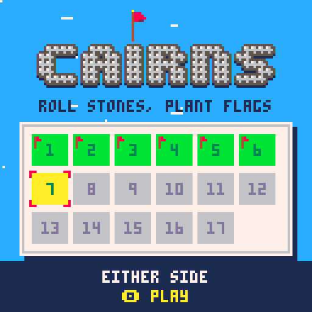
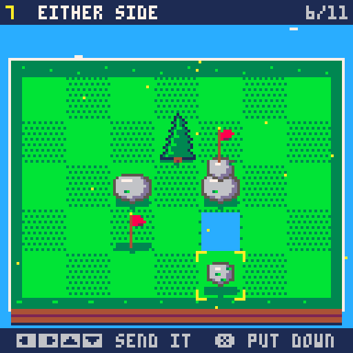

# Cairns

A stone-stacking puzzle for **PICO-8** (128×128, 16 colours): roll mossy
stones around a little grassy island and stack them into cairns with a flag
on top. It's a port of the "grassland cairns" look of
[Snowstack](https://github.com/koaning/ps-love2d/tree/main/games/snowstack),
with all 17 of its puzzles.

| Cartridge | Gameplay |
| --- | --- |
|  |  |

## The rules

- **Rolling:** a stone rolls in a straight line until the next square holds a
  piece or a pine tree, and stops in front of it. A roll that nothing stops
  isn't allowed, because the stone would roll into the sea.
- **Stacking:** a small stone next to a big stone hops on top of it. A flag
  next to a big + small stack hops on top and finishes the cairn. Nothing else
  stacks.
- **Flags never roll**, and stacked stones never move again.
- **Solved** when every piece is part of a finished cairn. Every level shows
  the fewest moves it can be done in.

## Play

### In PICO-8

```bash
make pico8    # runs: pico8 -run pico8/cairns.p8 (set PICO8=/path/to/pico8 if needed)
make play     # exports a standalone player to dist/cairns.bin/ and opens it (macOS)
```

Arrows move, 🅾️ / Enter picks a piece up, ❎ undoes, hold ❎ or R restarts,
P opens the menu. Inside the PICO-8 app Esc goes to PICO-8's editor: type
`resume` to get back to the game.

### In a browser (no PICO-8 binary required)

```bash
make fetch-lovejs   # once: download the love.js runtime for the preview player
make serve          # build dist/site and serve it on :8000 (PORT=9000 to change)
```

`make serve` builds `dist/site/` and serves it with the COOP/COEP headers the
browser player needs:

- `/`: the cart running on `pico8/preview/`, a small PICO-8 stand-in player
- `/official/`: also included when the `pico8` binary is installed (real PICO-8 HTML export)

## Develop

```bash
make test          # rule tests + level solver, cart smoke test, token meter, sound check
make music         # recompile tools/music.lua (sfx + music) into the cart
make screenshots   # replay a scripted run on the preview player (needs LÖVE)
```

More on the cart's files, controls and sound in [pico8/README.md](pico8/README.md).
