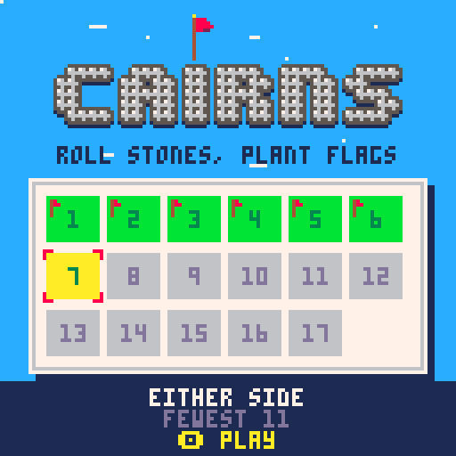
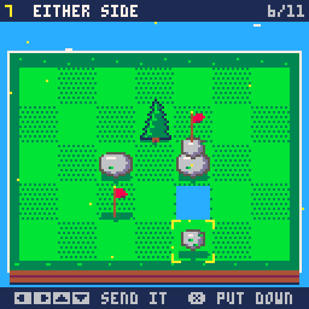

# Cairns — PICO-8 cart

| Cartridge | Gameplay |
| --- | --- |
|  |  |

```bash
pico8 -run cairns.p8     # or `make pico8` from the repo root
```

The cart is `cairns.p8`, which `#include`s:

| File | What |
| --- | --- |
| `levels.lua` | the 17 puzzles: name, fewest moves, board |
| `rules.lua` | reading a board, rolling, stacking, solved (ported from snowstack) |
| `main.lua` | title + level select, island and stone renderer, animations, undo, menu, saves, sfx |

Edit the `.lua` files in any editor. PICO-8 picks them up on `run`. To
export a standalone `.p8.png`/HTML, load the cart in PICO-8 and `save` /
`export`; includes get baked in at that point.

## Controls

- Title: ⬅️➡️⬆️⬇️ pick a level, 🅾️ play. Levels open one by one as you solve them.
- Game: ⬅️➡️⬆️⬇️ move the cursor, 🅾️ pick up the stone or flag under it,
  then ⬅️➡️⬆️⬇️ send it that way. 🅾️ or ❎ puts it down again.
- ❎ with nothing picked up undoes a move. Hold ❎ for the menu: resume, undo,
  restart, level select. Restart and level select are in PICO-8's pause menu too.

While a piece is picked up, the squares it can go to light up: **blue** where
it would roll to (with a dotted trail), **orange** where it would hop onto a
stack. A way that isn't allowed makes the piece shake.

## Levels

One string per board, rows split by `|`, the first row is the far side:

```lua
{ "pine stop", 4, ".......|.m.t...|.......|..lh...|......." },
```

`.` grass, `t` pine tree, `l` big stone, `m` small stone, `h` flag. Every level
is 7 × 5 and has as many big stones as small stones and flags. `make test`
solves every level with a breadth-first search (`tools/solve.lua`) and fails
when the fewest-moves number is wrong.

## Saved progress

`cartdata("koaning_cairns")`: `dget(0)` is the highest level solved,
`dget(1..17)` your fewest moves on each level, `dget(20)` the level played
last (the title opens on it).

## Sound

`tools/music.lua` holds everything you hear and compiles it into the cart:

- sfx 0-7, the sound effects, written as short note strings: pick up, put
  down, the rumble of a rolling stone (once per square), the thunk of a stack,
  the chime of a planted flag, a bump, undo, and a fanfare when a level is solved.
- sfx 8+ and `__music__`: two calm chord loops with no lead melody,
  "high moor" on the title screen (pattern 0) and "sea breeze" in game
  (pattern 4). A plucked sine harp arpeggio over a triangle bass.

```bash
make music   # rewrite the cart's sound data after editing the scores
```

`make test` fails if the cart's sound data is stale. The cart plays music
with `music(n, fade, 3)`, which reserves channels 0-1 so sfx always have 2-3.
If you edit the sound in PICO-8's editors instead, stop using the score
because `make music` would overwrite those edits.

## Preview player (no PICO-8 needed)

`preview/` is a small PICO-8 stand-in written in LÖVE. It reads
`cairns.p8`, resolves its `#include`s and runs the cart against a minimal
PICO-8 API: 128×128 framebuffer, the 16-colour palette, shapes, fill
patterns, a 3×5 font, buttons, coroutines, `cartdata` saved in LÖVE's save
folder, and a tiny synth (`preview/synth.lua`) for the `__sfx__` and
`__music__` sections.

```bash
make pico8-preview && love dist/cairns-p8.love   # desktop
make serve                                       # browser
make screenshots                                 # scripted run, see preview/shots.lua
```

`make screenshots` plays a scripted run (`preview/shots.lua`), saves
`docs/screenshots/*.png`, and writes the title screen into the cart's
`__label__` (`tools/label.lua`), which PICO-8 needs for `export`.

Colours, font and sound are approximations. Use real PICO-8 to judge
how the cart looks and sounds.
